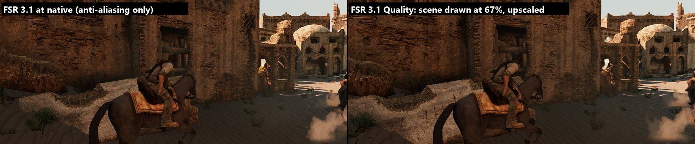
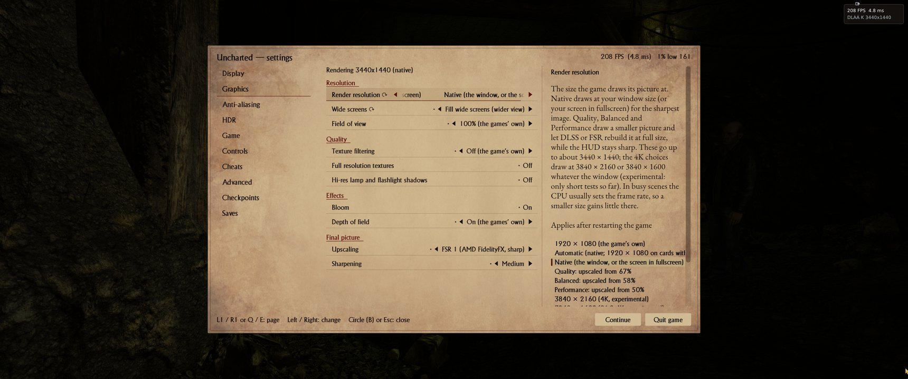
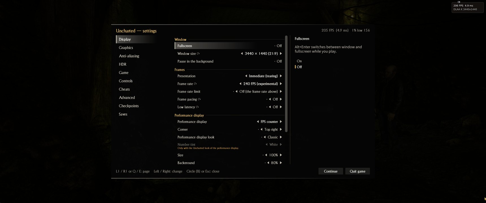
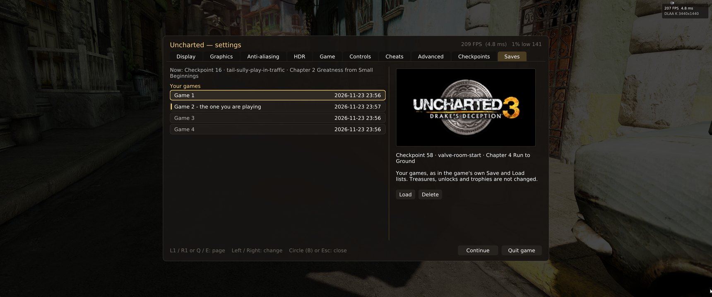
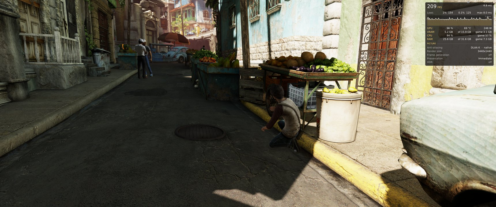

# Uncharted: The Nathan Drake Collection for Windows — Mevlock's fork

> [!WARNING]
> **Unofficial fork.** This is a hobby fork of [SuperMedo's uncharted_pc](https://github.com/Supermedo/uncharted_pc),
> the official port. Please don't report problems with this fork to him; open an issue here instead.

Uncharted 1, 2 and 3 from the PS4 collection, running natively on Windows 10 and 11. The original PS4 game
code runs directly on your PC and the graphics are translated to Vulkan.

**[⬇ Download 0.3.6.68](https://github.com/Mevlock/uncharted_pc-dev/releases/latest)** ·
[What's new](docs/releases/v0.3.6.68.md) · [How much faster](docs/PERFORMANCE.md) · [Known issues](#known-issues) · [How the shader preparation works](docs/SHADER_PREPARATION.md)

> **No game files are included.** You need your own decrypted dump of the collection, version 1.02:
> EU/UK (CUSA02343), US (CUSA02320), EU/Russian (CUSA02344) or Spanish (CUSA02826). The folder holds eboot.bin,
> big2-ps4_Shipping.elf, big3-ps4_Shipping.elf, sce_sys, u1data, u2data and u3data.
> Not affiliated with Sony Interactive Entertainment or Naughty Dog.

## Getting started

1. Unpack the zip into a new folder and start **`Uncharted.exe`**.
2. Pick your game folder, choose a game, press **PLAY**.
3. **First start of each game:** a *Preparing shaders* page builds the game's shaders once, so you don't get
   stutter from them while you play. On a fast PC that takes about half a minute for Uncharted 3, on a slower
   one a minute or two (less for Uncharted 1 and 2). The game waits behind the page; later starts skip it.

**Updates:** the launcher checks this page for a new version and offers to install it. Your saves, settings,
shader cache and art are never replaced. You can turn the check off in the launcher.

**Coming from an older version or another port:** copy your `user\savedata` folder over, or point
**Saves folder** in the launcher at it.

## What this fork adds

### Smooth from the first minute
- **Shader preparation:** every shader the games use is built once before you play, so there is **no shader-compile
  stutter in play**. The first start of each game shows a short *Preparing shaders* page; later starts skip it.
- **Frame pacing:** even frame times on fixed-refresh and VRR (G-SYNC / FreeSync) displays; the balanced mode costs
  next to nothing.
- **NVIDIA Reflex** low-latency modes, and a frame rate limit that counts generated frames.
- **High frame rates:** 30 to 240 FPS, with gameplay speed unchanged at every rate.
- **Faster GPU translation:** the port's CPU-side work runs on several threads and skips most of its old waiting.
  Busy scenes run up to about twice as fast as the original 0.3.6 at native resolution, more where the processor
  is the limit. *Measured on one PC (RTX 5080); your numbers will differ.* Step by step: [docs/PERFORMANCE.md](docs/PERFORMANCE.md).
- **Optimised builds:** profile-guided (PGO) builds tuned on real gameplay, and idle game threads that sleep on
  processors with few cores.

### Modern upscaling and anti-aliasing
- **NVIDIA DLSS 4:** DLAA, Quality, Balanced and Performance, with the newest models (K, L, M) to choose from.
- **AMD FSR 3.1 and FSR 4:** the game draws its 3D scene at the smaller size and FSR rebuilds it before the game's
  own post-processing: a cleaner picture and a real saving on the graphics card at Quality, Balanced and Performance.
- **Intel XeSS** and the games' own TAA.
- **Frame generation:** DLSS (up to 4× on RTX 50, 2× on RTX 40) or FSR 3 (any GPU), with the HUD kept clean.
- **Real motion vectors** from the games' velocity pass, with fixes for riders, vehicles and moving platforms;
  optional **character motion vectors** give the upscaler the exact motion of every moving character and object.

*Uncharted 3 at 3440×1440: FSR 3.1 at native (left) and at Quality (right), where the game draws its scene at 67%
and FSR rebuilds it at full size.*

### Picture
- **Render resolution:** your screen's resolution (up to 3440×1440; native 4K experimental), or below it with
  DLSS, FSR or XeSS rebuilding the full size.
- **Ultrawide** (21:9, 32:9) with a wider view in gameplay and a field of view setting; menus and videos stay 16:9.
- **HDR**, with brightness settings for the game and the menus.
- **Depth of field** and **bloom** options, texture filtering, full-resolution textures and sharper lamp shadows
  (Uncharted 2 and 3).

### Controls
- **Mouse look** for aiming, cover and mounted guns; keyboard, mouse and controller together, all remappable.
- **The mouse in the games' menus**, with the games' golden menu cursor.
- **Button prompts follow what you play with:** keyboard and mouse, PlayStation or Xbox (two Xbox styles).

### Saves and convenience
- **Several save games per game**, like the PS4 save screen, each with its picture.
- **Checkpoint select:** go to any checkpoint of the game you are playing.
- **Skip the intro logos** and the friends' stats notice; **Quit** from the games' own main menus.
- Trophies (in-game notice and a launcher page), Add to Steam, desktop shortcuts, crash-safe saves.
- **Cheats and unlocks** (optional): infinite health and ammo, no reload, one-hit kills, grenades, all chapters,
  all rewards.

### Coming next: the in-game menu
Every setting while you play, without the launcher (F1, or L3+R3 on a controller). Most options apply at once:
anti-aliasing and upscaler, DLSS model, field of view, effects, frame rate limit, even the cheats. Three looks
(Drake's journal, Uncharted, Classic), save and checkpoint pages, and a configurable performance display.
*In testing; the pictures show test builds.*

*Drake's journal style: each option explained on the right, its values listed in place.*

*Uncharted style, in the games' own font.*

*Saves: every game with its picture; load or delete without leaving the game.*

*The performance display: frame rate, 1% lows, frame-time graph, GPU, VRAM, CPU and the picture settings in use.*

### Game fixes
- **Uncharted 2, chapter 21 (convoy):** Elena's truck no longer sinks into the snow after the enemy truck rams it.
- **Uncharted 1, jet ski:** floating barrels no longer freeze in mid-air above 60 FPS.
- **Uncharted 1 and 2:** no more stops on the game's move-list check at high frame rates.
- **Uncharted 3:** Sully's shirt no longer throws dark triangles across the screen (Cartagena); the
  chapter 8 fort crash is gone.
- **NVIDIA:** no more graphics-device-lost crashes in Uncharted 1 and 2 above about 55 FPS.

### Convenience
- **Skip the intro logos** and **skip the friends' stats notice** after Continue / New Game.
- Keyboard, mouse and controller together, all remappable; button prompts follow what you play with.
- Trophies (in-game notice and a launcher page), Add to Steam, desktop shortcuts, crash-safe saves.

## Requirements

- Windows 10 (1903 or later) or 11, 64-bit.
- A processor with AVX: Intel Core 4th generation or newer (older Intel Core runs with a slower fallback),
  AMD Ryzen or FX.
- A graphics card with Vulkan 1.3, a current driver and **6 GB of video memory or more** (4 GB cards: keep
  anti-aliasing and frame generation off).
- About 8 GB of free memory (RAM + page file).

## Known issues

- The shader preparation is tested on NVIDIA and AMD graphics; Intel Arc reports are welcome (Intel integrated
  graphics is not supported).
- The first start after updating to 0.3.6.68 rebuilds the shader cache once.
- Frame rates above 120 are experimental.

**Reporting a problem:** open an issue with the game, chapter, your graphics card, and `user\last_run.log`
from the game folder (copy it right after the problem; the next start overwrites it).

## More

- [Release notes](docs/releases/) · [Performance, step by step](docs/PERFORMANCE.md) · [What is finished and what is not](docs/STATUS.md) ·
  [How the shader preparation was built](docs/SHADER_PREPARATION.md)
- Building: MSYS2 CLANG64, `bash build.sh`, then `bash packaging/windows/package.sh`.

## Credits

Built on SuperMedo's [uncharted_pc](https://github.com/Supermedo/uncharted_pc), on
[bbport](https://github.com/deadinside28/bloodborne_pc) by deadinside28 and on the
[shadPS4](https://github.com/shadps4-emu/shadPS4) renderer.

Fixes and features from: [Umar](https://github.com/Umar-Qayyum-dev) (button prompts, keyboard layouts,
the NVIDIA large-workgroup fix), [drakolordx7](https://github.com/drakolordx7/uncharted_pc) (first-sight
stutter, Uncharted 2 crash fixes, Xbox prompts, trophies, XeSS, the convoy speed fix),
[BilalReloaded](https://github.com/bc160201983/Uncharted-The-Nathan-Drake-Collection-PC-port) (idle thread
sleep, the render target heap move, chapter unlocks, mouse look: src/runtime_mouselook.c), [G3545](https://github.com/G3545),
[d4rksp4rt4n](https://github.com/d4rksp4rt4n), [eduardoghi](https://github.com/eduardoghi),
[iannitram](https://github.com/iannitram), [antikmewzik](https://github.com/antikmewzik/uncharted_pc_controls_qol)
(keyboard, mouse and Xbox button prompts: gpu/shim/bbport_keyicons.cpp; the mouse in the menus: src/runtime_menumouse.c),
[spacepepperoni](https://github.com/spacepepperoni/uncharted_Linux), [zorde23](https://github.com/zorde23/Uncharted_Collection_PC),
[kj2223](https://github.com/kj2223/uncharted_pc-fixes), [che2281337](https://github.com/che2281337/uncharted_pc).

Also used: FSR-Vulkan and the AMD FidelityFX SDK, NVIDIA DLSS, Intel XeSS, Videodec2 and the DLSS bridge from
IFreemz's shadPS4 Bloodborne build.

The launcher's pictures (the game scenes, the map banner, the compass emblem and the icon) are original artwork drawn by code (packaging/windows/make_uncharted_art.py); no official art or game images are included.
